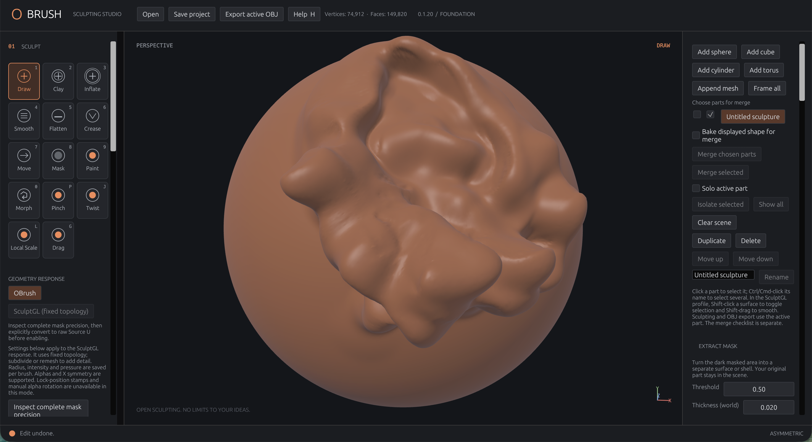

# OBrush

An open-source 3D sculpting app for desktop and the browser, built in Rust.
Sculpting runs locally. No account required.

**[Try it in your browser](https://obrush.app/)** ·
[Download the macOS alpha](https://github.com/Reza2kn/OBrush/releases) ·
[Report a bug](https://github.com/Reza2kn/OBrush/issues/new?template=bug_report.yml)



## What you can do

- Shape meshes with Draw, Clay, Move, Smooth, Crease and other brushes.
- Use masks, vertex painting, X symmetry and pressure controls.
- Work with multiple objects, subdivision, remeshing and sculpt layers.
- Undo and redo strokes, and save editable `.obrush` projects.
- Import and export OBJ, PLY and STL files.

The browser app is available now. The packaged desktop alpha is for **Apple Silicon Macs**;
Windows and Linux builds need testing.

## Still early

OBrush is a **public alpha**. The immediate priorities are brush quality,
responsiveness and reliable saves:

- Repeated strokes can stop building or leave jagged areas.
- Dense meshes can lag; physical pen and tablet support needs more testing.
- There is no autosave or crash recovery yet. Save `.obrush` copies regularly.

See [known issues and platform support](docs/PUBLIC_ALPHA.md) for details.

## Help shape it

Try a real sculpting task and tell us what gets in your way.
A short reproduction, your tool settings, and a screenshot or sample project help.

[Report a bug](https://github.com/Reza2kn/OBrush/issues/new?template=bug_report.yml) ·
[Suggest a feature](https://github.com/Reza2kn/OBrush/issues/new?template=feature_request.yml) ·
[Browse issues and vote with 👍](https://github.com/Reza2kn/OBrush/issues)

Code, documentation, testing and artwork contributions are welcome.
Start with [contributing](CONTRIBUTING.md), [build instructions](docs/BUILDING.md)
or the [controls guide](docs/CONTROLS.md).

## Run from source

With Rust installed:

```sh
cargo run --locked -p obrush-app --release
```

For browser builds and macOS packaging, see [build instructions](docs/BUILDING.md).
Technical details and historical checks live in [development notes](docs/DEVELOPMENT_NOTES.md).

Licensed under [MIT](LICENSE-MIT) or [Apache-2.0](LICENSE-APACHE), at your option.
